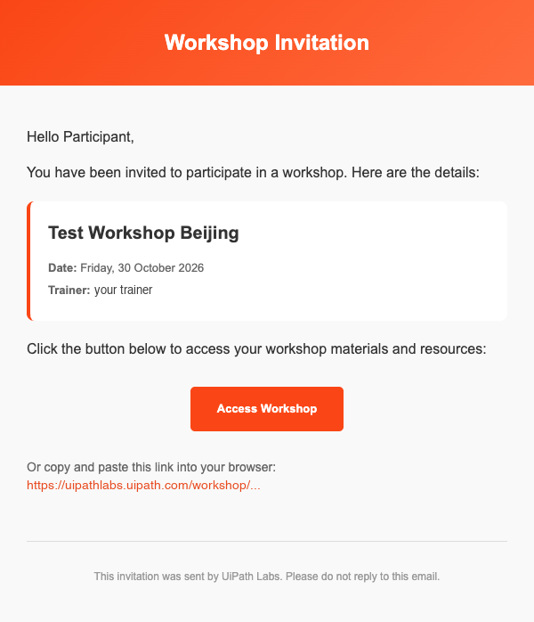
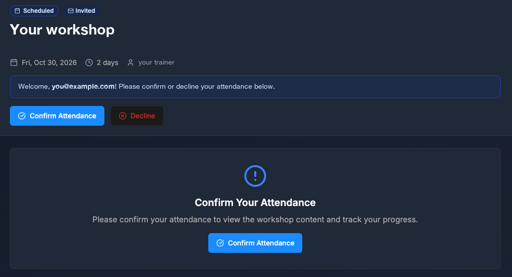
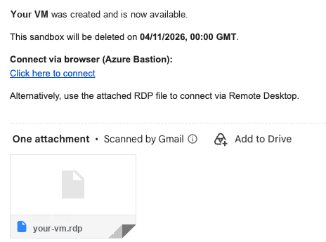
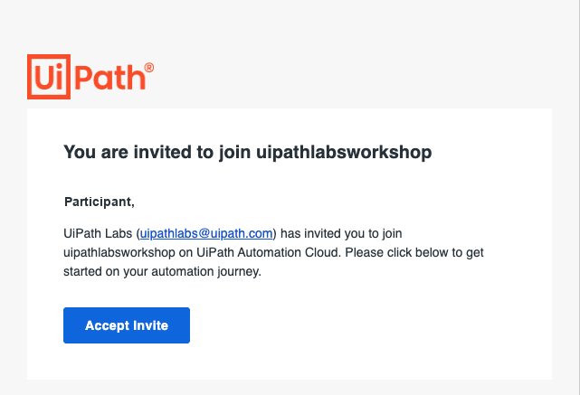
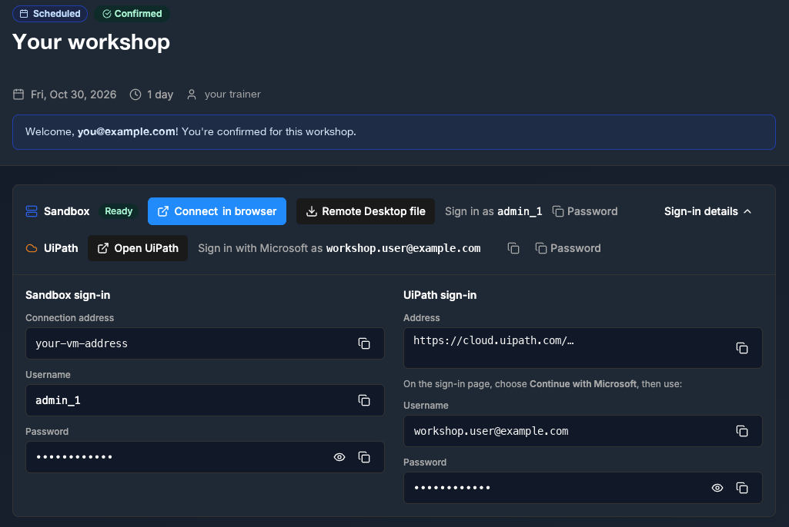

Step 1 of 3
{: .eyebrow }

# 📋 Before You Start

**What you receive from UiPath Labs, and what you need on your own machine.**

## 📨 The details you receive

Before the workshop, you receive two emails from **UiPath Labs** (`UiPathlabs@uipath.com`). You may already have them in your inbox. Can't find them? Check your spam folder. You might also get a third email, which you ignore.

### ✉️ Email 1: Workshop Invitation

The subject is **Workshop Invitation:** and the workshop's name. It gives the date and the trainer of your workshop.

{ .screenshot width="480" }

1. Select **Access Workshop**, or copy the link from the email into Chrome. Don't forward the email: the link is yours.
2. The workshop page opens. It shows the workshop's name, date, length, and trainer, and welcomes you by your email address.
3. Select **Confirm Attendance**. Don't select **Decline**.

    { .screenshot width="560" }

4. After you confirm, the page shows the workshop content and your UiPath Labs details.

### 🖥️ Email 2: Sandbox created

The subject is **Sandbox created**. It tells you that your VM is ready, and when it's deleted. It also has a **Click here to connect** link for Azure Bastion, and an RDP file attached.

{ .screenshot width="420" }

Keep this email, but you don't need its link: you connect from the workshop page in the next step.

!!! warning "Your VM has an end date"
    The VM is deleted at the date and time in this email, with everything on it. Finish the workshop before then.

### 🚫 Ignore: You are invited to join uipathlabsworkshop

You might also get an email from **UiPath Platform** (`no-reply@uipath.com`) with the subject **You are invited to join uipathlabsworkshop**. You don't need it.

{ .screenshot width="420" }

!!! warning "Don't select Accept Invite"
    Ignore this email. You sign in with the workshop account from your UiPath Labs details, not through this invite.

### 🗂️ Your UiPath Labs details

After you confirm, the workshop page shows your sign-in details. If they're hidden, select **Sign-in details**. Keep this page open in a browser tab: you'll copy from it in the next steps.

{ .screenshot width="600" }

🖥️
Sandbox sign-in (left)

Your VM. Its **Username** and **Password**, with copy buttons, and two ways to connect: **Connect in browser** and **Remote Desktop file**.

➡️ Used in [Connect to your VM](connect-to-your-vm.md)

👤
UiPath sign-in (right)

Your workshop account. The **Username** and **Password** you use with **Continue with Microsoft**.

➡️ Used in [Sign in](sign-in.md)

!!! warning "Ignore the UiPath address"
    Don't use the **Address** under **UiPath sign-in**, or the **Open UiPath** button. The workshop uses **{{ training_url }}**. From **UiPath sign-in**, you only need the **Username** and **Password**.

!!! warning "Two different accounts"
    The Sandbox username signs you in to Windows on the VM. The UiPath username signs you in to UiPath. Don't mix them up, and don't use your own UiPath account during the workshop.

## 💻 What you need on your own machine

- A **Remote Desktop client**. On Windows, **Remote Desktop Connection** is built in. On a Mac, install **Windows App** from the App Store.
- **Google Chrome**, up to date, for the workshop page. It also opens the VM if you use Azure Bastion.
- **Clipboard access** to the VM. You'll paste usernames, passwords, and commands into it.
- A stable internet connection. Close video calls you don't need.

You don't need to install anything else: every workshop tool runs inside the VM.

!!! tip "Keep your details private"
    Your VM and workshop account are yours for the session. Don't share the passwords, or paste them into a chat or a coding agent.

!!! success "Ready for the next step"
    You have the workshop page open with your sign-in details, and a Remote Desktop client and Chrome on your machine. Next: [connect to your VM](connect-to-your-vm.md).
