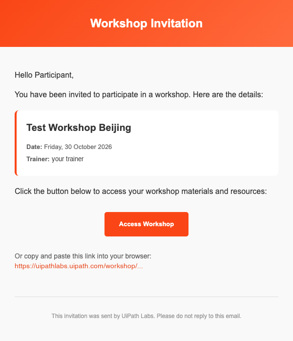
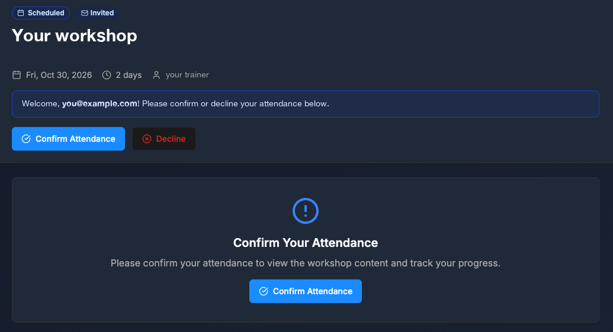
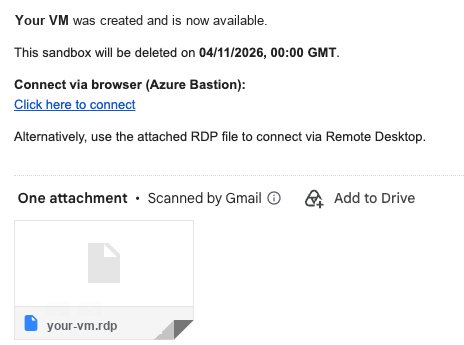
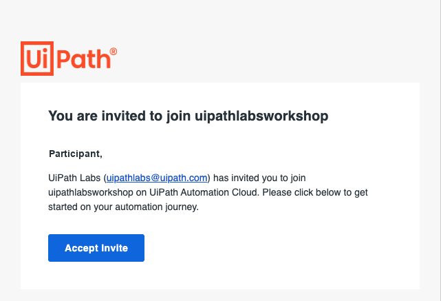
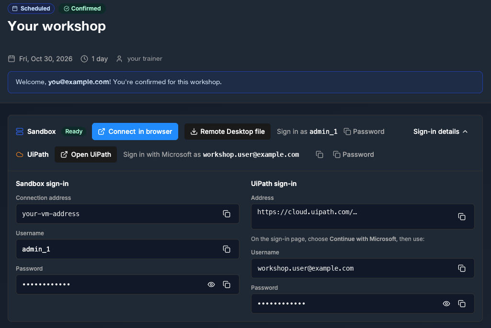

第 1 步，共 3 步
{: .eyebrow }

# 📋 开始之前 { #before-you-start }

**你会从 UiPath Labs 收到什么，以及你自己的电脑需要准备什么。**

## 📨 你会收到的信息 { #the-details-you-receive }

工作坊开始前，你会收到 **UiPath Labs**（`UiPathlabs@uipath.com`）发来的两封邮件。它们可能已经在你的收件箱里了。找不到？检查一下垃圾邮件文件夹。你还可能收到第三封邮件，忽略它即可。

### ✉️ 邮件 1：Workshop Invitation { #email-1-workshop-invitation }

主题为 **Workshop Invitation:** 加上工作坊名称。邮件中写明了工作坊的日期和讲师。

{ .screenshot width="480" }

1. 选择 **Access Workshop**，或者把邮件中的链接复制到 Chrome 中。不要转发这封邮件：这个链接只属于你。
2. 工作坊页面随即打开。页面上显示工作坊的名称、日期、时长和讲师，并用你的邮箱地址向你问好。
3. 选择 **Confirm Attendance**。不要选择 **Decline**。

    { .screenshot width="560" }

4. 确认之后，页面会显示工作坊内容和你的 UiPath Labs 信息。

### 🖥️ 邮件 2：Sandbox created { #email-2-sandbox-created }

主题为 **Sandbox created**。邮件告诉你虚拟机已经准备好，以及它的删除时间。邮件中还有一个用于 Azure Bastion 的 **Click here to connect** 链接，并附有一个 RDP 文件。

{ .screenshot width="420" }

保留这封邮件，但不需要使用其中的链接：下一步你会通过工作坊页面进行连接。

!!! warning "你的虚拟机有截止时间"
    到了邮件中写明的日期和时间，虚拟机会连同其中的所有内容一起被删除。请在此之前完成工作坊。

### 🚫 忽略：You are invited to join uipathlabsworkshop { #ignore-you-are-invited-to-join-uipathlabsworkshop }

你还可能收到一封来自 **UiPath Platform**（`no-reply@uipath.com`）的邮件，主题为 **You are invited to join uipathlabsworkshop**。你不需要这封邮件。

{ .screenshot width="420" }

!!! warning "不要选择 Accept Invite"
    忽略这封邮件。你要使用 UiPath Labs 信息中的工作坊账号登录，而不是通过这个邀请登录。

### 🗂️ 你的 UiPath Labs 信息 { #your-uipath-labs-details }

确认之后，工作坊页面会显示你的登录信息。如果它们被隐藏了，选择 **Sign-in details**。把这个页面保持在一个浏览器标签页中打开：接下来的步骤里你要从中复制内容。

{ .screenshot width="600" }

🖥️
Sandbox sign-in（左侧）

你的虚拟机。其中有 **Username** 和 **Password**（带复制按钮），以及两种连接方式：**Connect in browser** 和 **Remote Desktop file**。

➡️ 用于[连接到虚拟机](connect-to-your-vm.md)

👤
UiPath sign-in（右侧）

你的工作坊账号。你通过 **Continue with Microsoft** 登录时使用的 **Username** 和 **Password**。

➡️ 用于[登录](sign-in.md)

!!! warning "忽略 UiPath 地址"
    不要使用 **UiPath sign-in** 下的 **Address**，也不要使用 **Open UiPath** 按钮。工作坊使用的是 **{{ training_url }}**。在 **UiPath sign-in** 中，你只需要 **Username** 和 **Password**。

!!! warning "两个不同的账号"
    Sandbox 用户名用于登录虚拟机上的 Windows。UiPath 用户名用于登录 UiPath。不要把两者弄混，工作坊期间也不要使用你自己的 UiPath 账号。

## 💻 你自己的电脑需要准备什么 { #what-you-need-on-your-own-machine }

- 一个**远程桌面客户端**。Windows 自带 **Remote Desktop Connection**。在 Mac 上，从 App Store 安装 **Windows App**。
- 最新版本的 **Google Chrome**，用于打开工作坊页面。如果你使用 Azure Bastion，虚拟机也会在 Chrome 中打开。
- 对虚拟机的**剪贴板访问权限**。你要把用户名、密码和命令粘贴到虚拟机中。
- 稳定的网络连接。关闭不需要的视频通话。

其他什么都不用安装：工作坊的所有工具都在虚拟机里运行。

!!! tip "保管好你的信息"
    你的虚拟机和工作坊账号在本次课程中归你使用。不要分享密码，也不要把密码粘贴到聊天窗口或编码智能体中。

!!! success "可以进入下一步了"
    你已经打开了显示登录信息的工作坊页面，电脑上也有远程桌面客户端和 Chrome。下一步：[连接到虚拟机](connect-to-your-vm.md)。
