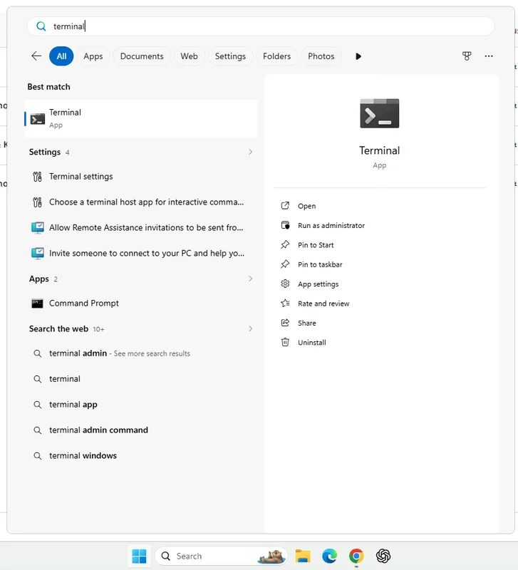

Step 4 of 4
{: .eyebrow }

# 💻 Coding Agent and CLI

**Start the Codex coding agent in the VM's terminal, check its model, and sign the `uip` CLI in to your tenant.**

## ⌨️ Open the terminal

1. In the VM, open the Windows search and type `terminal`.
2. Select the **Terminal** app.

    { .screenshot width="500" }

## 🤖 Start Codex

1. In the terminal, type `codex` and press **Enter**. Codex starts in a few moments.

    ```bash
    codex
    ```

2. Type `/status` and press **Enter**. Check that the model and the reasoning effort are the ones the trainer names.
3. If they aren't, type `/model`, pick the model and the reasoning effort the trainer names, then check `/status` again.

!!! info "One Codex session for the whole workshop"
    Keep this Codex session open all day. It remembers what you built and the IDs it looked up. If the conversation gets long, type `/compact` to summarize it and free up space.

## 🔐 Sign the uip CLI in

The `uip` CLI is how Codex talks to UiPath. Sign it in to the workshop tenant once.

1. In Codex, type this command. The `!` at the start runs it in the shell instead of sending it to Codex as a prompt:

    ```bash
    ! uip login --authority {{ training_authority }} --organization {{ training_org }} --tenant {{ training_tenant }}
    ```

2. A **Ready to automate!** tab opens in Chrome, and the terminal shows a successful authentication message. Close the tab.
3. Ask Codex to check the login:

    ```text
    Run uip login status and tell me the host, organization, and tenant.
    ```

    It must report `{{ training_authority }}`, the organization **{{ training_org }}**, and the tenant **{{ training_tenant }}**. If any of them is different, stop and tell the trainer.

!!! tip "The tools are already there"
    The VM comes with Codex, the `uip` CLI, and the UiPath skills installed. Don't upgrade or reinstall them unless the trainer asks you to.

## ✅ Check you're ready

- The VM's desktop is open in your browser, and pasting into it works.
- Chrome in the VM is signed in with your workshop account, and Studio Web shows **{{ training_tenant }}**.
- Codex is running in the terminal, with the model the trainer named.
- `uip login status` reports **{{ training_org }}** and **{{ training_tenant }}**.

!!! success "You're set up"
    Your UiPath Labs environment is ready. If something above isn't true, check [Troubleshooting](troubleshooting.md) or raise your hand.
