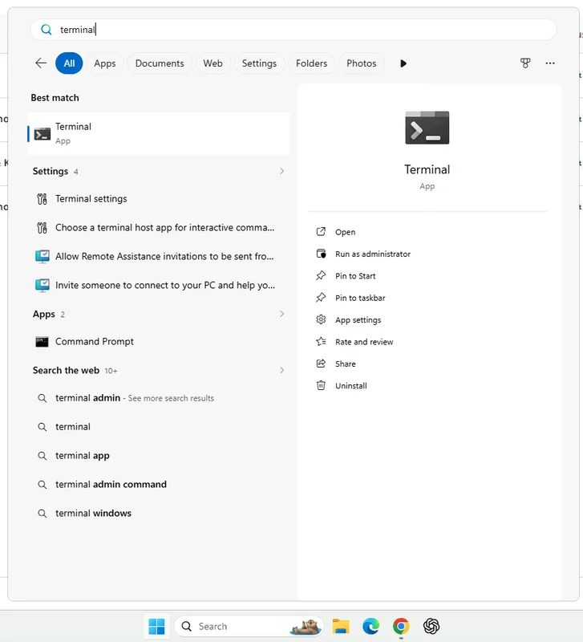

第 4 步，共 4 步
{: .eyebrow }

# 💻 编码智能体与 CLI { #coding-agent-and-cli }

**在虚拟机的终端中启动 Codex 编码智能体，检查它的模型，并让 `uip` CLI 登录到你的租户。**

## ⌨️ 打开终端 { #open-the-terminal }

1. 在虚拟机中打开 Windows 搜索，输入 `terminal`。
2. 选择 **Terminal** 应用。

    { .screenshot width="500" }

## 🤖 启动 Codex { #start-codex }

1. 在终端中输入 `codex` 并按 **Enter**。Codex 片刻后就会启动。

    ```bash
    codex
    ```

2. 输入 `/status` 并按 **Enter**。检查模型和推理强度是否与讲师指定的一致。
3. 如果不一致，输入 `/model`，选择讲师指定的模型和推理强度，然后再次用 `/status` 检查。

!!! info "整个工作坊使用同一个 Codex 会话"
    全天保持这个 Codex 会话打开。它会记住你构建的内容以及它查到的 ID。如果对话变得很长，输入 `/compact` 对其进行总结并释放空间。

## 🔐 让 uip CLI 登录 { #sign-the-uip-cli-in }

`uip` CLI 是 Codex 与 UiPath 通信的方式。让它登录到工作坊租户一次即可。

1. 在 Codex 中输入下面的命令。开头的 `!` 会让命令在 shell 中运行，而不是作为提示词发送给 Codex：

    ```bash
    ! uip login --authority {{ training_authority }} --organization {{ training_org }} --tenant {{ training_tenant }}
    ```

2. Chrome 中会打开一个 **Ready to automate!** 标签页，终端会显示身份验证成功的消息。关闭该标签页。
3. 让 Codex 检查登录情况：

    ```text
    Run uip login status and tell me the host, organization, and tenant.
    ```

    它必须报告 `{{ training_authority }}`、组织 **{{ training_org }}** 和租户 **{{ training_tenant }}**。如果其中任何一项不同，停下来告诉讲师。

!!! tip "工具已经装好了"
    虚拟机已经安装了 Codex、`uip` CLI 和 UiPath skills。除非讲师要求，否则不要升级或重新安装它们。

## ✅ 检查是否准备就绪 { #check-youre-ready }

- 虚拟机的桌面已在浏览器中打开，并且可以粘贴内容。
- 虚拟机中的 Chrome 已用你的工作坊账号登录，Studio Web 显示 **{{ training_tenant }}**。
- Codex 正在终端中运行，使用的是讲师指定的模型。
- `uip login status` 报告 **{{ training_org }}** 和 **{{ training_tenant }}**。

!!! success "环境准备完成"
    你的 UiPath Labs 环境已经就绪。如果上面有任何一项不成立，请查看[故障排除](troubleshooting.md)或举手。
