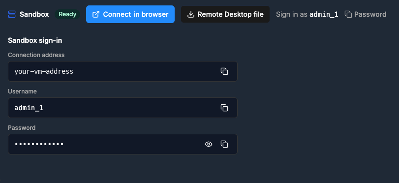
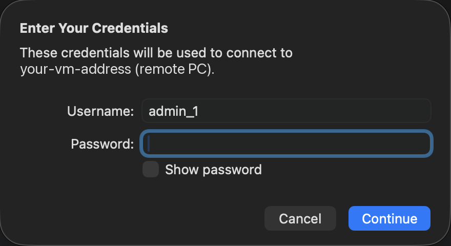
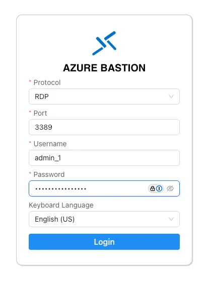
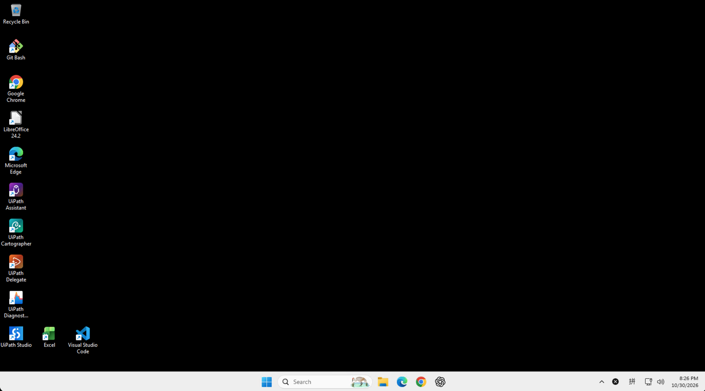

Step 2 of 3
{: .eyebrow }

# 🖥️ Connect to Your VM

**Open your VM with Remote Desktop, or in a browser tab with Azure Bastion. From here on, you work inside the VM.**

## 🔌 Choose how to connect

Open your workshop page. **Sandbox sign-in** shows the VM's **Username** and **Password**, with copy buttons.

{ .screenshot width="480" }

Remote Desktop is the recommended way. Use Azure Bastion if you can't use a Remote Desktop client.

=== "🖥️ Remote Desktop (recommended)"

    1. Next to **Sandbox**, select **Remote Desktop file**.
    2. Open the downloaded `.rdp` file. It opens in **Remote Desktop Connection** on Windows, or in **Windows App** on a Mac.
    3. When you're asked for credentials, enter the **Username** from **Sandbox sign-in**: `admin_1`.
    4. Select the copy button next to **Password** in **Sandbox sign-in**, paste the password, and select **Continue**.

        { .screenshot width="440" }

    5. If you're warned that the VM's certificate can't be verified, select **Continue**.
    6. Wait for the VM's Windows desktop to load.

=== "🌐 Azure Bastion"

    Azure Bastion opens the VM in a Chrome tab, so you don't need a Remote Desktop client.

    1. Next to **Sandbox**, select **Connect in browser**.
    2. In the **Azure Bastion** form, keep **Protocol** on **RDP** and **Port** on **3389**. Enter the **Username** and **Password** from **Sandbox sign-in**, pick your **Keyboard Language**, and select **Login**.

        { .screenshot width="420" }

    3. When your browser asks whether to allow clipboard access, accept it.
    4. Wait for the VM's Windows desktop to load in the browser tab.

    !!! warning "Can't paste into the VM with Ctrl+V?"
        In Chrome on your own machine, open `chrome://settings/content/clipboard` and make sure the Bastion site isn't under **Not allowed to see your clipboard**. Then reload the Bastion tab.

## 🧰 Your VM desktop

When the VM opens, you see its Windows desktop. This is where you work in the hands-on workshops. Your work stays on the VM until the date in the **Sandbox created** email.

{ .screenshot width="640" }

The tools you need are already installed, with shortcuts on the desktop: **Google Chrome**, **UiPath Studio**, **UiPath Assistant**, **Visual Studio Code**, **Git Bash**, and **Excel**. You don't need to install anything.

## 📋 Check copy and paste

Copy something on your own machine, then paste it into the VM, for example into the Windows search box. If it pastes, you're done.

!!! success "Ready for the next step"
    The VM's desktop is open, and pasting into it works. From now on, do every step inside the VM. Next: [sign in](sign-in.md).
