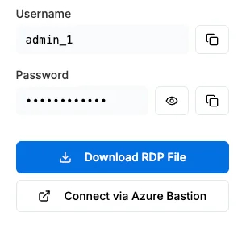
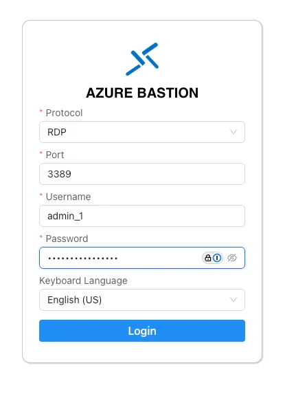

第 2 步，共 4 步
{: .eyebrow }

# 🖥️ 连接到虚拟机 { #connect-to-your-vm }

**通过 Azure Bastion 在浏览器标签页中打开你的虚拟机。从这里开始，你都在虚拟机里操作。**

## 🔌 通过 Azure Bastion 连接 { #connect-through-azure-bastion }

Azure Bastion 会在 Chrome 标签页中打开虚拟机，所以你不需要远程桌面客户端。

1. 打开你的虚拟机信息。其中显示虚拟机的 **Username** 和 **Password**，并带有复制按钮。
2. 选择 **Connect via Azure Bastion**。

    { .screenshot width="320" }

3. 在 **Azure Bastion** 表单中，保持 **Protocol** 为 **RDP**、**Port** 为 **3389**。输入虚拟机的用户名和密码，选择你的 **Keyboard Language**，然后选择 **Login**。

    { .screenshot width="420" }

4. 浏览器询问是否允许访问剪贴板时，选择允许。
5. 等待虚拟机的 Windows 桌面在浏览器标签页中加载完成。

!!! tip "更想用远程桌面客户端？"
    **Download RDP File** 会给你一个文件，用远程桌面打开虚拟机。只有在讲师要求时才使用它：推荐的方式是 Azure Bastion。

## 📋 检查复制和粘贴 { #check-copy-and-paste }

在你自己的电脑上复制一些内容，然后粘贴到虚拟机中，例如粘贴到 Windows 搜索框里。如果能粘贴进去，这一步就完成了。

!!! warning "无法用 Ctrl+V 粘贴到虚拟机？"
    在你自己电脑上的 Chrome 中打开 `chrome://settings/content/clipboard`，确认 Bastion 网站不在 **Not allowed to see your clipboard** 列表中。然后重新加载 Bastion 标签页。

!!! success "可以进入下一步了"
    虚拟机的桌面已在 Chrome 标签页中打开，并且可以粘贴内容。从现在起，每一步都在虚拟机中完成。下一步：[登录](sign-in.md)。
