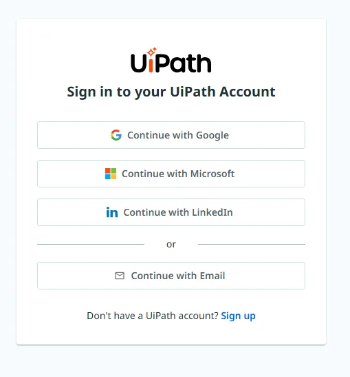
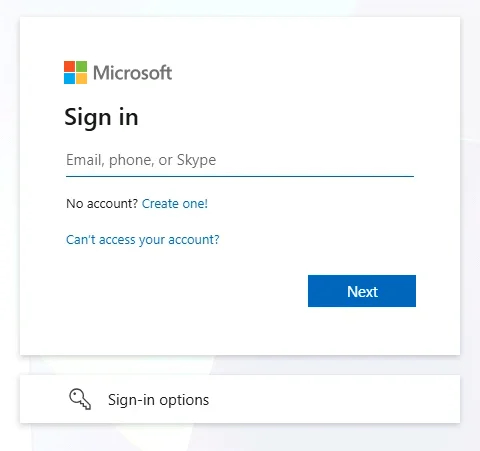
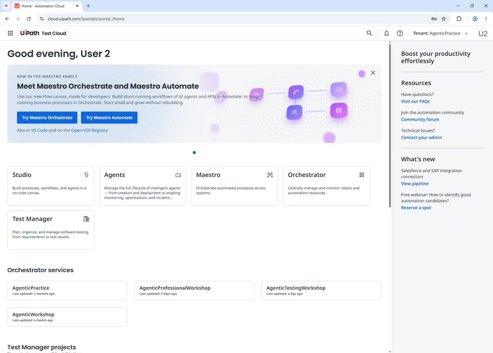
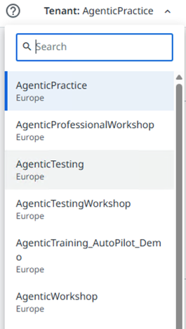

Step 3 of 3
{: .eyebrow }

# 🔑 Sign In

**Sign in to UiPath inside the VM with your workshop account, and check you can see both workshop tenants.**

## 🌐 Sign in with your workshop account

1. Open **Google Chrome** in the VM and go to **[{{ training_url }}]({{ training_url }})**. Don't use **Open UiPath** on the workshop page: it opens another address.
2. Select **Continue with Microsoft**.

    { .screenshot width="420" }

3. Enter the **Username** from **UiPath sign-in** and select **Next**.

    { .screenshot width="420" }

4. Enter the **Password** from **UiPath sign-in** and select **Sign in**.
5. The home page of **{{ training_url }}** opens. Check that the address bar shows `cloud.uipath.com/{{ training_org }}`.

    { .screenshot width="640" }

!!! warning "Use the workshop account, not your own"
    If Chrome signs you in with another account, sign out, then sign in again with **Continue with Microsoft** and your workshop account.

## ✅ Check your tenants

Your workshop account has access to two tenants: **{{ agentic_tenant }}** and **{{ training_tenant }}**. Check that you can see both.

1. In the upper-right corner, open the **Tenant** picker.
2. Check that the list has **{{ agentic_tenant }}** and **{{ training_tenant }}**. To find them faster, type a name in **Search**.

    { .screenshot width="240" }

3. If one of them is missing, tell the trainer.

!!! tip "Switch tenants with the Tenant picker"
    The trainer tells you which tenant each workshop uses. Select it in the **Tenant** picker before you start. **Orchestrator services**, on the home page, lists the same tenants.

!!! tip "Keep this tab open"
    You'll come back to this Chrome tab during the workshop. If a page ever goes blank or shows an old screen, open it in a fresh tab and check the tenant again.

!!! success "Ready for the workshop"
    You're signed in at **{{ training_url }}** with your workshop account, and the **Tenant** picker shows **{{ agentic_tenant }}** and **{{ training_tenant }}**. Your environment is ready for the workshop.
