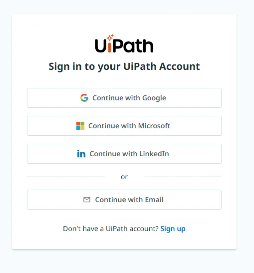
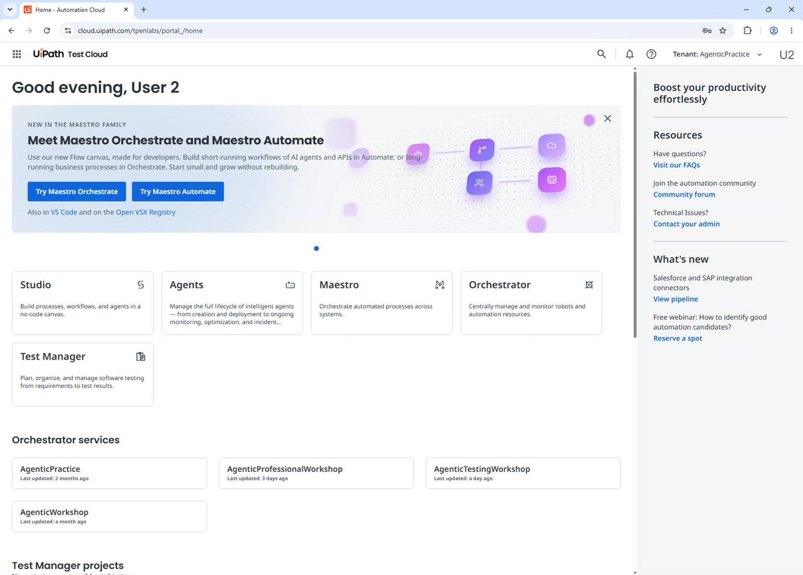
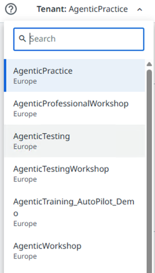

第 3 步，共 3 步
{: .eyebrow }

# 🔑 登录 { #sign-in }

**在虚拟机中用你的工作坊账号登录 UiPath，并检查你能看到两个工作坊租户。**

## 🌐 用你的工作坊账号登录 { #sign-in-with-your-workshop-account }

1. 在虚拟机中打开 **Google Chrome**，访问 **[{{ training_url }}]({{ training_url }})**。不要使用工作坊页面上的 **Open UiPath**：它会打开另一个地址。
2. 选择 **Continue with Microsoft**。

    { .screenshot width="420" }

3. 输入 **UiPath sign-in** 中的 **Username**，然后选择 **Next**。

    { .screenshot width="420" }

4. 输入 **UiPath sign-in** 中的 **Password**，然后选择 **Sign in**。
5. **{{ training_url }}** 的主页随即打开。检查地址栏显示的是 `cloud.uipath.com/{{ training_org }}`。

    { .screenshot width="640" }

!!! warning "使用工作坊账号，而不是你自己的账号"
    如果 Chrome 用另一个账号让你登录了，请先退出登录，再通过 **Continue with Microsoft** 用你的工作坊账号重新登录。

## ✅ 检查你的租户 { #check-your-tenants }

你的工作坊账号可以访问两个租户：**{{ agentic_tenant }}** 和 **{{ training_tenant }}**。检查你能看到这两个租户。

1. 在右上角，打开 **Tenant** 选择器。
2. 检查列表中有 **{{ agentic_tenant }}** 和 **{{ training_tenant }}**。想更快找到，可以在 **Search** 中输入名称。

    { .screenshot width="240" }

3. 如果缺少其中一个，告诉讲师。

!!! tip "用 Tenant 选择器切换租户"
    讲师会告诉你每个工作坊使用哪个租户。开始之前，在 **Tenant** 选择器中选择它。主页上的 **Orchestrator services** 也列出了同样的租户。

!!! tip "保持这个标签页打开"
    工作坊期间你还会回到这个 Chrome 标签页。如果某个页面出现空白或显示旧页面，在新标签页中打开它，并再次检查租户。

!!! success "可以开始工作坊了"
    你已经用工作坊账号登录 **{{ training_url }}**，**Tenant** 选择器中显示 **{{ agentic_tenant }}** 和 **{{ training_tenant }}**。你的环境已经为工作坊准备好了。
