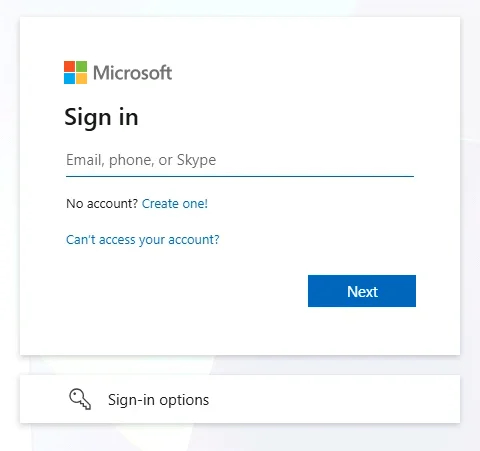

第 3 步，共 4 步
{: .eyebrow }

# 🔑 登录 { #sign-in }

**在虚拟机中用你的工作坊账号登录 UiPath，并检查你是否在正确的租户上。**

## 🌐 用你的工作坊账号登录 { #sign-in-with-your-workshop-account }

1. 在虚拟机中打开 **Google Chrome**，访问 **[{{ training_url }}]({{ training_url }})**。工作坊账号信息中的 **Open UiPath Environment** 按钮会打开同一个页面。
2. 选择 **Continue with Microsoft**。

    { .screenshot width="420" }

3. 输入 **Your Workshop Account** 中的用户名，然后选择 **Next**。

    { .screenshot width="420" }

4. 输入工作坊账号的密码，然后选择 **Sign in**。

!!! warning "使用工作坊账号，而不是你自己的账号"
    如果 Chrome 用另一个账号让你登录了，请先退出登录，再通过 **Continue with Microsoft** 用你的工作坊账号重新登录。

## ✅ 确认租户 { #confirm-the-tenant }

1. 登录后，打开 **Studio Web**。
2. 在右上角，检查租户选择器显示的是 **{{ training_tenant }}**。
3. 如果显示的是其他租户，切换到 **{{ training_tenant }}**。

!!! tip "保持这个标签页打开"
    工作坊期间你还会回到这个 Chrome 标签页。如果 Studio Web 出现空白或显示旧页面，在新标签页中打开它，并再次检查租户。

!!! success "可以进入下一步了"
    你已经用工作坊账号登录，Studio Web 显示 **{{ training_tenant }}**。下一步：[编码智能体与 CLI](coding-agent-and-cli.md)。
